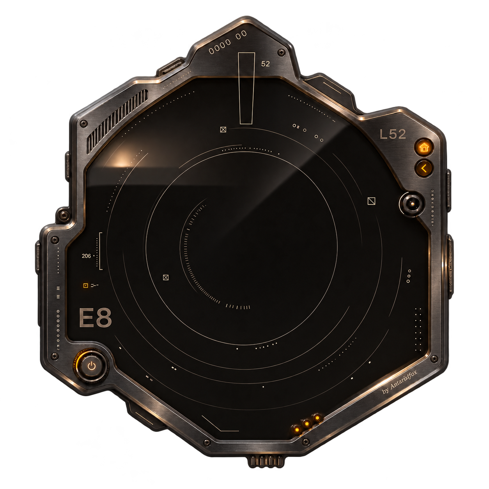

# Atmosphere · by Antarikfox

**Анимированная карточка температуры и влажности для Home Assistant.** Графитовый корпус, дымчатое стекло, янтарные показания, клубящийся туман, движущиеся шкалы и блики.

**Версия: 2.0.1-beta.1.** Публичная бета: нужны отзывы о работе на разных темах HA, браузерах и планшетах. Это программная карточка, не физический датчик и не интеграция оборудования.



## Возможности

- Температура и влажность из выбранных `sensor.*`; температура в °F автоматически переводится в °C.
- Комната, датчики и внешний вид задаются в визуальном редакторе карточки.
- Живой туман, кольца, полосы, блики и искры; пауза и регулировка скорости.
- Всплывающие окна с показателями, историей за 24 часа / 7 / 30 дней, статистикой и CSV.
- Фон из темы HA, свой цвет, картинка или прозрачность; размытие фона.
- Тонировка корпуса и цвет живой подсветки. Часть отражений и физических LED запечена в исходную графику и сохраняет исходный цвет.
- Внешние скругления, рамка и тень следуют переменным темы HA.
- Графика встроена в один JS-файл: отдельно загружать PNG не требуется.
- Нет зависимости от Browser Mod, дополнительных карточек или внешних CDN.

## Установка через HACS как пользовательский репозиторий

После публикации этого репозитория:

1. Открой HACS → меню ⋮ → пользовательские репозитории.
2. Добавь `https://github.com/Antarikfox/antarikfox-atmosphere`, категория **Dashboard / Панель**.
3. Найди **Atmosphere · by Antarikfox** и установи.
4. Если HACS не зарегистрировал ресурс автоматически, добавь JavaScript-модуль:
   `/hacsfiles/antarikfox-atmosphere/antarikfox-atmosphere.js`.
5. Обнови страницу HA и добавь карточку **Atmosphere · by Antarikfox**.

Репозиторий подготовлен под требования пользовательского репозитория HACS. Он не является частью стандартного каталога HACS и не прошёл его модерацию. Если предварительный релиз не предлагается, можно установить ветку `main`.

## Ручная установка, в том числе с планшета

1. Скачай [antarikfox-atmosphere.js.txt](downloads/antarikfox-atmosphere.js.txt).
2. Убери последнее `.txt`, получив `antarikfox-atmosphere.js`.
3. Положи его в `/config/www/` (в File editor папка может называться `/homeassistant/www/`).
4. Добавь ресурс `/local/antarikfox-atmosphere.js?v=201-beta1`, тип **JavaScript-модуль**.
5. Закрой вкладку HA и открой её заново. Если `www` создаёшь впервые, перезапусти HA.

Не загружай одновременно ручной и HACS-ресурс одной карточки. Для перехода на HACS убери старую запись ресурса.

## Настройка

```yaml
type: custom:antarikfox-atmosphere
room: Моя комната
temperature_entity: sensor.room_temperature
humidity_entity: sensor.room_humidity
instance_id: atmosphere_room
background_mode: theme
animation: true
sparks: true
grid_options:
  columns: 12
  rows: auto
```

`temperature_entity` и `humidity_entity` в примере — **заглушки**: выбери реальные объекты своего HA в редакторе. Карточка без выбранных датчиков показывает пояснение и позволяет открыть настройки. В коде нет entity_id автора.

- **Редактор карточки HA** сохраняет общую конфигурацию панели для всех устройств.
- **Круглая ручка справа на приборе** открывает быстрые настройки, которые сохраняются в текущем браузере. Кнопка «Вернуть настройки из HA» убирает локальные переопределения.
- Для нескольких приборов задавай разные `instance_id`.

Черновик формы не сбрасывается при обновлении датчиков. Неверные границы комфорта показывают сообщение, сохраняя введённые числа.

## Кнопки

| На приборе | Действие |
| --- | --- |
| Домик и Atmosphere | Обзор климата |
| Стрелка под домиком | История и статистика |
| Круглая ручка справа, название комнаты | Настройки |
| Питание слева снизу | Пауза декоративной анимации; датчики продолжают обновляться |
| Показания температуры / влажности | Подробности соответствующего датчика |
| Три светодиода снизу | Состояние подключения |

Окна закрываются крестиком, Escape и нажатием за пределами окна. Главный экран остаётся без графиков.

## Ограничения

- История читается из Recorder HA. Для длинной статистики нужны поддерживающие её датчики (обычно `state_class: measurement`) и накопленные записи.
- Декоративные шкалы художественные; ориентируйся на цифровые показания. Движение облака не является прогнозом погоды.
- Общий фон и корпус независимы: прозрачность фона не делает металл прозрачным.
- По умолчанию учитывается системное «Уменьшение движения». Пункт можно изменить в настройках карточки.
- Canvas ограничен примерно 25 кадрами/секунду; анимация приостанавливается вне экрана и в скрытой вкладке.
- Основной объём единственного JS-файла — встроенная графика. Первая загрузка тяжелее обычной минималистичной карточки.
- Исходная версия 2.0.0 проверялась в Chromium с тестовыми ответами HA. Для публичной беты добавлены локальные проверки конфигурации, данных и сборки; совместимость со всеми версиями HA не заявляется.

## Демонстрация

Самостоятельный HTML: [docs/index.html](docs/index.html). Скачай и открой его в браузере: данные в нём явно помечены как тестовые. В GitHub файл по этой ссылке показывается как исходник. Для онлайн-демо включи GitHub Pages с источником **main / docs**.

## Разработка

Нужны Python 3.10+ и Node.js 20+. Пакеты npm/pip для сборки не требуются.

```sh
python3 scripts/build.py
python3 scripts/validate.py
node --test tests/*.test.cjs
```

Редактируй `src/antarikfox-atmosphere.js`, а не собранный файл. Исходные PNG лежат в `assets/`. Сборка создаёт `dist/antarikfox-atmosphere.js`, копию `.js.txt` для планшетов и автономное демо. Коммить обновлённые результаты сборки: HACS устанавливает готовый файл без запуска Python.

[Изменения](CHANGELOG.md) · [Участие](CONTRIBUTING.md) · [Публикация](PUBLISHING.md)

## Лицензия

Код и поставляемая графика распространяются по [MIT](LICENSE). Сохраняй уведомление об авторстве. Векторная надпись использует контуры DejaVu Sans ExtraLight; отдельное уведомление находится в [THIRD_PARTY_NOTICES.md](THIRD_PARTY_NOTICES.md) и комментарии JS.

**by Antarikfox**
